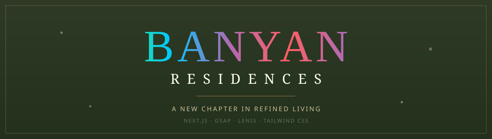
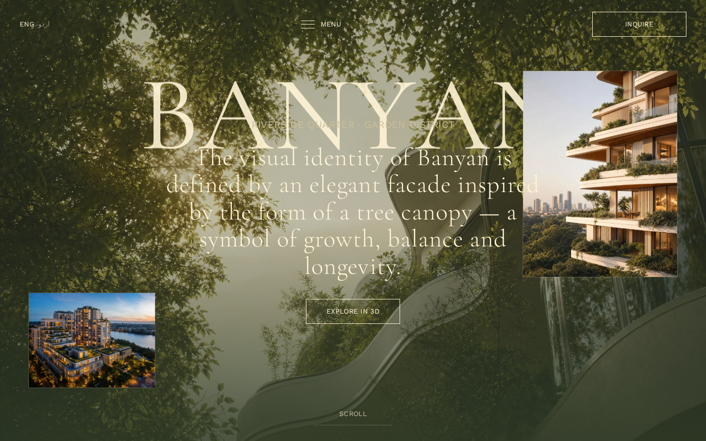
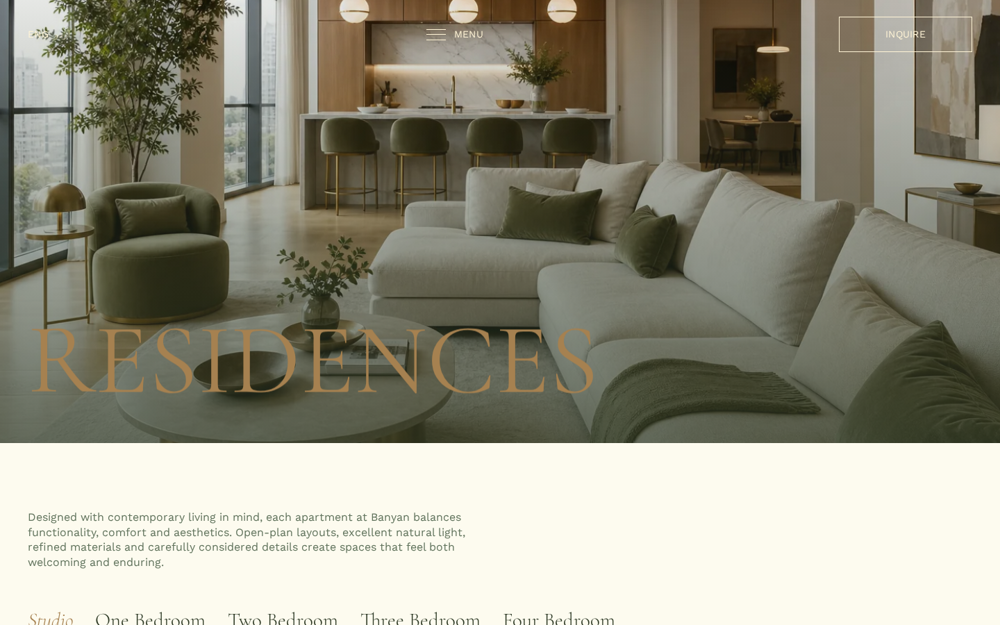
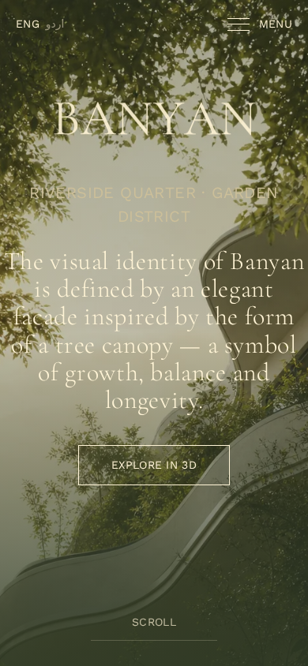

<div align="center">



<br/><br/>

<a href="#"></a>


<br/><br/>

**A cinematic, award-style luxury real-estate website template.**
Pinned scroll sequences, split-text reveals, a custom cursor, buttery smooth scrolling and a
canopy-inspired design system — built to feel hand-crafted, not generated.

</div>


- 🎬 **Cinematic preloader** with an animated percentage counter and brand reveal
- 🖱️ **Custom cursor** with a trailing ring and hover states (auto-disabled on touch)
- 🌊 **Lenis smooth scrolling** synced perfectly with GSAP ScrollTrigger
- 📌 **Pinned hero sequence** — three rotating headlines with parallax floating frames
- ✂️ **Split-text animations** — headings reveal character-by-character and word-by-word
- 🗺️ **Interactive neighbourhood map** with hover-driven points of interest
- 🏠 **Filterable residences & retail listings** with room / wing / floor / area filters and unit modal
- 🌿 **Dark "Your Roots" section** with scroll-driven word illumination
- ↔️ **Horizontal "View from above"** scroll section with drifting clouds
- 📅 **Installment timeline**, amenities tabs, business wings and a newsletter footer
- 📱 **Fully responsive** — tailored layouts for desktop, tablet and mobile
- ♿ **Reduced-motion support** and semantic, accessible markup
- 🚀 **Static export** — deploys to GitHub Pages by drag-and-drop, no server needed


| Layer         | Technology                                                    |
| ------------- | ------------------------------------------------------------- |
| Framework     | [Next.js 15](https://nextjs.org/) (App Router, static export) |
| Animation     | [GSAP 3](https://gsap.com/) + ScrollTrigger                   |
| Smooth scroll | [Lenis](https://lenis.darkroom.engineering/)                  |
| Styling       | [Tailwind CSS v4](https://tailwindcss.com/)                   |
| Fonts         | Work Sans + Cormorant Garamond (self-hosted)                  |
| Language      | React 19 / JavaScript                                         |


```text
banyan-residences/
├─ docs/                  # Pre-built static site (GitHub Pages serves this)
│  ├─ index.html
│  ├─ _next/              # Compiled CSS / JS / fonts
│  ├─ images/             # Optimised WebP assets
│  └─ .nojekyll           # Tells Pages to serve _next/ as-is
├─ src/
│  ├─ app/                # Routes (home, residences, business, retail, contact…)
│  ├─ components/         # Header, Footer, Cursor, Preloader, sections…
│  │  └─ home/            # Homepage sections
│  ├─ lib/                # gsap setup, text splitter, content data
│  └─ fonts/              # Self-hosted WOFF2 fonts
├─ public/images/         # Source images
├─ assets/                # README banners & screenshots
├─ next.config.mjs        # Static export + base path config
├─ package.json
└─ README.md
```


> Requires **Node.js 18.18+** (Node 20 recommended).

```bash
# 1. Install dependencies
npm install

# 2. Start the dev server
npm run dev
# → open http://localhost:3000

# 3. Build the static site (outputs to /out)
npm run build
```

The development server runs at `http://localhost:3000` with hot reload.


This template ships **pre-built** in the `docs/` folder, so you can publish without any build tools.

1. Create a new repository named **`banyan-residences`**.
2. Upload the contents of this folder (drag-and-drop on github.com).
3. Go to **Settings → Pages → Build and deployment → Deploy from a branch**.
4. Select branch **`main`** and folder **`/docs`**, then **Save**.
5. Your site goes live at `https://<your-username>.github.io/banyan-residences/`.

> 📦 **More than 100 files?** GitHub's web uploader accepts ~100 files per commit.
> Upload `docs/` + `README.md` first (the site goes live), then add `src/`, `public/` and the
> config files in a second upload. A full step-by-step walkthrough is in **`PUBLISH-GUIDE.md`**.

**Using a different repository name?** Rebuild with your own base path:

```bash
NEXT_PUBLIC_BASE_PATH="/your-repo-name" npm run build
# then copy /out into /docs and re-upload
```


Almost everything lives in **one file** — `src/lib/data.js`:

- 🏷️ Brand name, phone, email, address → `brand`
- 🧭 Navigation → `nav`
- 🗺️ Points of interest → `around`
- 🏠 Residence types & inventory → `residenceTypes`, `residenceUnits`
- 🏢 Business wings, amenities, installment plan → `businessWings`, `amenities`, `installment`

**Colors & fonts** live in `src/app/globals.css` (the `@theme` block).
**Images** live in `public/images/` — swap the WebP files and keep the same names, or update the paths in `data.js`.


<div align="center">



<em>The pinned hero — canopy backdrop, serif wordmark and floating parallax frames.</em>

<br/><br/>



<em>Residences — full-bleed imagery with a golden split-text reveal.</em>

<br/><br/>



<em>Fully responsive, down to the smallest screens.</em>

</div>


Released under the **MIT License** — free to use, modify and ship in personal and commercial projects.
Attribution is appreciated but not required. See [`LICENSE`](LICENSE) for details.

<br/>


<div align="center">

## 💖 Support

If you found this template helpful, please consider leaving a **star** 🌟 on the repository!

</div>

<div align="center">


<sub>© Banyan Residences Template · Built with Next.js, GSAP, Lenis & Tailwind CSS</sub>

</div>
